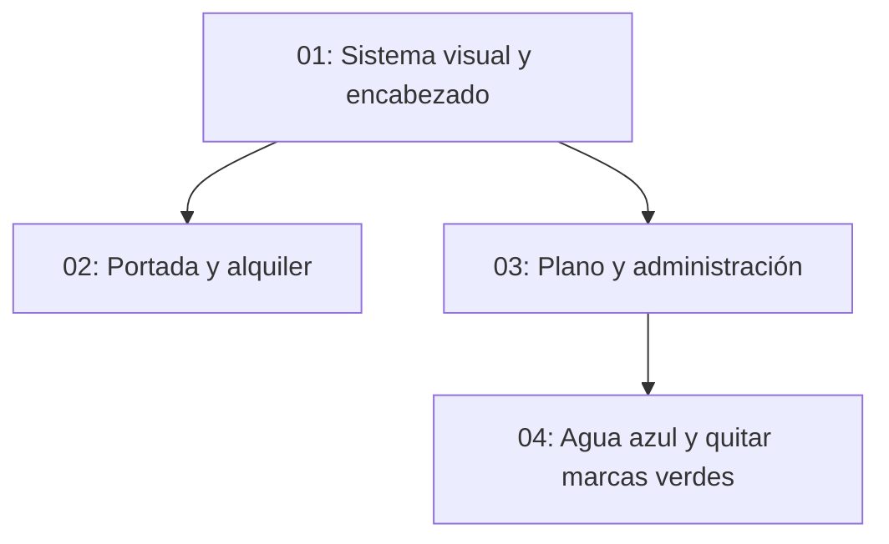

# Diseño coherente de La Palmerina

## Overview

Propuesta pendiente de aprobación: conservar la identidad editorial de la portada (crema, tinta y cobre; títulos serif) y extenderla a la navegación y presentación de las páginas existentes, manteniendo contenido y funciones.

## Quick Links

- [Requirements](./requirements.md)
- [Action Required](./action-required.md)

## Dependency Graph

## Waves

| Wave | Tasks | Description |
| --- | --- | --- |
| 1 | task-01 | Tokens y encabezado compartido |
| 2 | task-02, task-03 | Aplicación a páginas sin superposición de archivos |
| 3 | task-04 | Ampliación solicitada: agua azul y retirar marcas verdes |

## Task Status

### Wave 1

- [x] [task-01-sistema](./tasks/task-01-sistema.md) — Sistema visual y navegación

### Wave 2

- [x] [task-02-comercial](./tasks/task-02-comercial.md) — Portada y alquiler
- [x] [task-03-herramientas](./tasks/task-03-herramientas.md) — Plano y administración

### Wave 3

- [x] [task-04-color-plano](./tasks/task-04-color-plano.md) — Agua azul y quitar marcas verdes

## Estado

Propuesta aprobada por el usuario. Wave 1 implementada y revisada: lint sin errores (warnings existentes/import order), typecheck aprobado. Acceso de red recuperado mediante permisos del entorno; instalación con Corepack pnpm 10.30.3. Usuario amplió alcance para colorear agua en St. Thomas; fuente recibida y corrección completada en Wave3.

## Verificación final

- Diseño aprobado e implementado en dos waves con revisión independiente PASS.
- Lint: 0 errores, 9 advertencias existentes. Typecheck aprobado.
- Build de producción aprobado.
- Navegador: portada, alquiler y plano a 375, 768 y 1440 px, sin overflow horizontal ni errores JavaScript. Menú móvil abre/cierra con Escape y restaura foco.
- Plano: búsqueda L-04, cambio de planta y tema comprobados. Retorno independiente conservado y retorno embebido redundante oculto.
- St. Thomas sin sesión redirige a ingreso; no se probó edición con sesión porque la imagen y los datos son privados.
- Wave3 completada: agua azul y rayas verdes retiradas contra el PDF real. Prueba de píxeles preserva árboles y negros/neutros; componente Chromium conserva estados, selección, zoom y recuperación. PDF vectorial corregido entregado fuera del repositorio.

## Fuente recibida

El usuario adjuntó el PDF original y pidió retirar las rayas verdes además de colorear el agua. Se identificaron agua cian en Agua_Hatch, marcas lima añadidas sin capa CAD y árboles verde oscuro que se conservan. El original y los archivos corregidos permanecen fuera del repositorio público. Publicación en main aún pendiente de autorización explícita.

## Wave3 completada

Revisión independiente PASS. Lint/typecheck aprobados; raster procesado solo en navegador sin modificar imagen almacenada ni publicar activos privados. Producción sigue pendiente de autorización explícita para fusionar PR#6.
