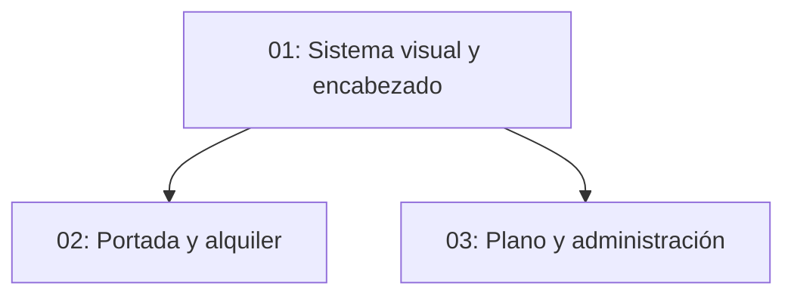

# Diseño coherente de La Palmerina

## Overview

Propuesta pendiente de aprobación: conservar la identidad editorial de la portada (crema, tinta y cobre; títulos serif) y extenderla a la navegación y presentación de las páginas existentes, manteniendo contenido y funciones.

## Quick Links

- [Requirements](./requirements.md)
- [Action Required](./action-required.md)

## Dependency Graph

## Waves

| Wave | Tasks | Description |
| --- | --- | --- |
| 1 | task-01 | Tokens y encabezado compartido |
| 2 | task-02, task-03 | Aplicación a páginas sin superposición de archivos |

## Task Status

### Wave 1

- [x] [task-01-sistema](./tasks/task-01-sistema.md) — Sistema visual y navegación

### Wave 2

- [x] [task-02-comercial](./tasks/task-02-comercial.md) — Portada y alquiler
- [x] [task-03-herramientas](./tasks/task-03-herramientas.md) — Plano y administración

## Estado

Propuesta aprobada por el usuario. Wave 1 implementada y revisada: lint sin errores (warnings existentes/import order), typecheck aprobado. Acceso de red recuperado mediante permisos del entorno; instalación con Corepack pnpm 10.30.3. Usuario amplió alcance para colorear agua en St. Thomas; imagen privada pendiente de acceso para delimitarla.

## Verificación final

- Diseño aprobado e implementado en dos waves con revisión independiente PASS.
- Lint: 0 errores, 9 advertencias existentes. Typecheck aprobado.
- Build de producción aprobado.
- Navegador: portada, alquiler y plano a 375, 768 y 1440 px, sin overflow horizontal ni errores JavaScript. Menú móvil abre/cierra con Escape y restaura foco.
- Plano: búsqueda L-04, cambio de planta y tema comprobados. Retorno independiente conservado y retorno embebido redundante oculto.
- St. Thomas sin sesión redirige a ingreso; no se probó edición con sesión porque la imagen y los datos son privados.
- Petición adicional de agua azul: se quitó el filtro monocromo para preservar los colores originales. Azul específico pendiente del archivo que el usuario indicó que adjuntará; no se inventó geometría.
